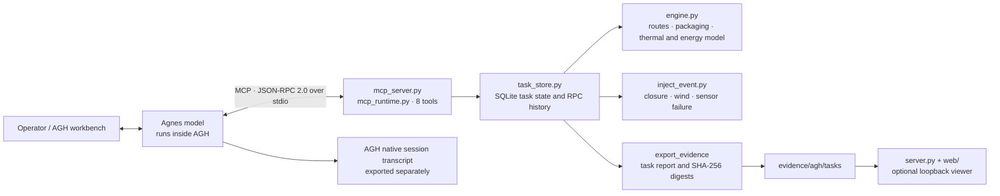

# Pharmacy Flight Guardian (药航守护)

English | [简体中文](README.zh-CN.md)

An AGH-integrated simulation for planning cold-chain medicine delivery by UAV under temperature, time, and energy constraints, then responding to disruptions with updated plans or a safe stop.

## 1. Project Overview

### Background

Cold-chain delivery planning must consider more than the shortest route. Thermal exposure, delivery deadlines, energy use, battery reserve, and changing conditions can affect the same delivery. Pharmacy Flight Guardian explores this problem with a synthetic digital twin and an agent workflow in Agnes Harness (AGH).

### Core capabilities

- Create a persistent delivery task with configurable synthetic conditions.
- Enumerate route and packaging candidates, then evaluate them against temperature, time, energy, and reserve constraints.
- Check candidate plans across eight uncertainty corners: ambient temperature, headwind, and packaging thermal time constant.
- Simulate the full remaining route before departure and advance execution one route segment at a time.
- Inject simulated route closures, stronger wind, or temperature-sensor failure. Re-plan from the current state when feasible; otherwise stop the simulation and leave the case for human handling.
- Verify the simulated delivery and export a task report with tool-call history and SHA-256 digests. An AGH session transcript is exported separately to document model activity.

### What is new in this prototype

- **Joint constraints:** Route and packaging choices are evaluated together against the thermal window, deadline, energy budget, and battery reserve rather than distance alone.
- **Closed-loop execution:** The model receives state from the tools after each simulated segment and can adjust its decision after an event. The Python engine enforces route and state constraints.
- **Uncertainty and explicit failure handling:** Candidate plans are checked at eight uncertainty corners; missing temperature data cannot be treated as a verified delivery. A safe abort can be the correct result for a boundary or fault case.
- **Reviewable runs:** The project records tool inputs and results, task state, code digests, and separately exported AGH traces. Digests help detect changes; they are not digital signatures or proof of identity.

### Scope and assumptions

The map contains six synthetic nodes and eight synthetic links, with standard and enhanced packaging options. Example defaults include a 2–8 °C temperature window, 5 °C initial package temperature, 32 °C ambient temperature, 1 m/s headwind, 320 Wh battery capacity, a 35 Wh reserve, and a 25-minute deadline. These are teaching and simulation parameters, not validated limits for a particular medicine or aircraft. The project does not control a real drone, certify airworthiness, or verify medicine quality.

## 2. Demo Video

[Watch the Pharmacy Flight Guardian demo on Bilibili](https://www.bilibili.com/video/BV17apz6PE5V/)

The project package lists the video duration as 269 seconds (4:29). The repository also includes a local result viewer and an offline simulation mode; those modes do not invoke Agnes and should not be presented as evidence of an AGH model run.

For Windows launch steps, AGH registration, evidence export, submission preparation, and troubleshooting, see the [Chinese project usage guide](USAGE.zh-CN.md).

## 3. Architecture



| Module | Responsibility |
| --- | --- |
| `mcp_server.py`, `mcp_runtime.py` | Expose the MCP stdio server, validate calls, and publish the eight-tool catalog. |
| `engine.py` | Enumerate synthetic routes and packaging choices; compute travel time, energy, thermal changes, uncertainty-corner results, and delivery status. |
| `task_store.py` | Persist task snapshots and tool-call inputs/results in SQLite so calls share the same simulation state. |
| `inject_event.py` | Apply simulated closure, wind, and sensor-failure events without resetting the task's position or resources. |
| `server.py`, `web/` | Serve a local viewer for saved MCP reports and a clearly labeled offline demo. |
| `agh_evidence.py`, `export_agh_session.py`, `collect_results.py` | Match project task evidence with separately exported AGH session records and assemble submission data. |

Typical flow: `create_task` → `plan_candidates` → `simulate_plan` → `execute_step` (one link at a time) → optional `inject_event` and re-planning → `verify_delivery` → `export_evidence`.

## 4. Integration Standards

### Protocol and tool contract

- **Transport:** MCP over standard input/output (stdio), using JSON-RPC 2.0. The server handles `initialize`, `ping`, `tools/list`, and `tools/call`, and recognizes MCP protocol versions `2024-11-05` and `2025-03-26`.
- **Tool schemas:** Defined in `mcp_tools.schema.json`; objects reject undeclared properties. Task IDs are the 12-character lowercase hexadecimal IDs returned by `create_task`. Routes use nodes `A`, `B`, `C`, `D`, `E`, and `R`; packaging is `standard` or `enhanced`.
- **Tools:** `create_task`, `plan_candidates`, `simulate_plan`, `execute_step`, `inject_event`, `abort_task`, `verify_delivery`, and `export_evidence`.
- **State:** Calls for a task share its SQLite-backed state. `execute_step` advances one link; it does not reset position, elapsed time, energy, or temperature. Packaging is fixed after departure.
- **Results:** Tool results are returned as MCP text content containing JSON. `export_evidence` writes a task report and SHA-256 values. The report does not authenticate the AGH model session; export and retain the AGH transcript separately.

### AGH integration

The project registers one stdio server named `yaohang-guard-final` through the installed AGH CLI. Python 3.10+ is required; the Python code uses only the standard library. The model runs in AGH, and this project neither stores model API keys nor sends model requests directly.

```bash
python run.py check
python run.py register --agh-cli /path/to/agnes.mjs
python run.py check-agh
```

After registration, review and enable the server in AGH Settings → MCP, then run tasks in an AGH session. On Windows, the package also provides `.bat` launchers. Use the project instructions to export the native AGH session separately from task evidence.

### Optional local viewer

```bash
python run.py serve --open
```

The viewer binds to `127.0.0.1` (port `8765` by default). It can show saved MCP reports or run the offline simulation; it is not a public API and does not produce AGH model-call evidence.

---

**Simulation boundary:** Temperatures, routes, flight energy, and disturbances are synthetic. The results are for engineering exploration and do not establish medical suitability, real-world delivery reliability, airspace authorization, or aircraft safety.
