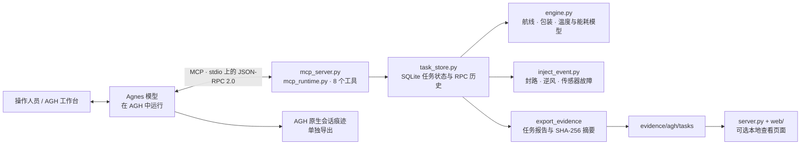

# 药航守护（Pharmacy Flight Guardian）

[English](README.md) | 简体中文

“药航守护”是一个集成 Agnes Harness（AGH）的仿真原型：在温度、时限和能耗约束下规划无人机冷链配送，并在途中发生变化时重新规划或安全停止。

## 1. 项目介绍（Project Overview）

### 项目背景

冷链配送规划不能只看最短路线。热暴露、交付时限、能耗、电池余量和途中变化会共同影响配送结果。药航守护使用合成数字孪生和 AGH 智能体工作流，探索这些因素的协同处理。

### 核心功能

- 创建并持久化配送仿真任务，支持设置合成环境参数。
- 枚举航线与包装候选方案，并按温度、时间、能耗和电量预留约束进行评估。
- 对候选方案进行八个不确定性角点检查，覆盖环境温度、逆风和包装热时间常数变化。
- 出发前验证完整剩余路线，执行时每次只推进一个航段。
- 注入封路、逆风增强或温度传感器失效事件；若仍有可行方案则基于当前状态重新规划，否则停止仿真并转人工处理。
- 验证仿真配送结果并导出任务报告、工具调用记录和 SHA-256 摘要。AGH 会话痕迹需单独导出，以记录模型活动。

### 创新亮点

- **联合约束决策：** 将路线和包装一起评估，同时考虑温度窗口、时限、能耗和电池余量，而非只按距离排序。
- **闭环执行：** 每个仿真航段结束后，模型接收工具返回的当前状态；遇到异常后可以调整决策，Python 仿真引擎负责校验路线和状态约束。
- **不确定性与显式失败处理：** 在八个不确定性角点检查候选方案；缺少温度观测时不能判定交付已验证。边界或故障测试中安全中止也可能是正确结果。
- **可复核运行记录：** 项目保存工具输入与结果、任务状态、代码摘要，并可与单独导出的 AGH 会话痕迹对应。摘要用于发现内容变化，不是数字签名或身份认证证明。

### 项目范围与假设

地图包含 6 个合成节点和 8 条合成航段，提供标准、加强两种包装选项。示例默认值包括 2–8°C 温度窗口、5°C 初始箱温、32°C 环境温度、1 m/s 逆风、320 Wh 电池容量、35 Wh 预留电量和 25 分钟时限。这些参数仅用于教学和仿真，并非针对特定药品或飞行器的验证指标。项目不控制真实无人机、不认证适航性，也不验证药品质量。

## 2. 视频介绍（Demo Video）

[在哔哩哔哩观看药航守护演示视频](https://www.bilibili.com/video/BV17apz6PE5V/)

项目包内提交信息记录的视频时长为 269 秒（4 分 29 秒）。项目还提供本地结果查看页面和离线仿真模式；它们不会调用 Agnes，也不能作为 AGH 模型运行的证据。

Windows 启动、AGH 接入、证据导出、提交材料整理和故障排查步骤，见[项目运行与提交指南](USAGE.zh-CN.md)。

## 3. 架构介绍（Architecture）



| 模块 | 职责 |
| --- | --- |
| `mcp_server.py`、`mcp_runtime.py` | 提供 MCP stdio 服务，校验工具调用并发布八个工具。 |
| `engine.py` | 枚举合成航线与包装方案，计算航时、能耗、温度变化、不确定性角点结果和交付状态。 |
| `task_store.py` | 使用 SQLite 持久化任务快照及工具调用参数、结果，让多次调用共享同一仿真状态。 |
| `inject_event.py` | 注入封路、逆风和传感器失效等仿真事件，同时保留任务位置和资源状态。 |
| `server.py`、`web/` | 为已保存的 MCP 报告和明确标记的离线演示提供本地查看页面。 |
| `agh_evidence.py`、`export_agh_session.py`、`collect_results.py` | 将项目任务证据与另行导出的 AGH 会话记录对应，并汇总提交数据。 |

典型调用链：`create_task` → `plan_candidates` → `simulate_plan` → `execute_step`（每次一段）→ 可选的 `inject_event` 与重新规划 → `verify_delivery` → `export_evidence`。

## 4. 集成标准（Integration Standards）

### 协议与工具接口

- **传输方式：** 通过标准输入/输出（stdio）使用 MCP，并采用 JSON-RPC 2.0。服务端处理 `initialize`、`ping`、`tools/list` 和 `tools/call`，识别 MCP 协议版本 `2024-11-05` 与 `2025-03-26`。
- **工具 Schema：** 定义于 `mcp_tools.schema.json`；对象不接受未声明字段。任务 ID 为 `create_task` 返回的 12 位小写十六进制字符串。路线节点为 `A`、`B`、`C`、`D`、`E`、`R`；包装枚举为 `standard` 或 `enhanced`。
- **工具清单：** `create_task`、`plan_candidates`、`simulate_plan`、`execute_step`、`inject_event`、`abort_task`、`verify_delivery`、`export_evidence`。
- **状态管理：** 同一任务的调用共享 SQLite 状态。`execute_step` 每次推进一条航段，并保留当前位置、已用时间、能耗和温度；起飞后包装方案固定。
- **结果格式：** 工具结果以包含 JSON 的 MCP 文本内容返回。`export_evidence` 写出任务报告和 SHA-256 值；该报告不能认证 AGH 模型会话，需另行导出和保留 AGH 会话记录。

### 接入 AGH

项目通过已安装的 AGH CLI 注册一个名为 `yaohang-guard-final` 的 stdio 服务。运行要求为 Python 3.10+；Python 代码仅使用标准库。模型在 AGH 中运行，项目不保存模型 API 密钥，也不直接向模型端点发送请求。

```bash
python run.py check
python run.py register --agh-cli /path/to/agnes.mjs
python run.py check-agh
```

注册后，在 AGH“设置 → MCP”中审核并启用该服务，再在 AGH 会话中运行任务。Windows 用户也可使用项目提供的 `.bat` 启动脚本。请按项目说明单独导出 AGH 原生会话记录，不要用任务报告替代模型调用痕迹。

### 可选本地查看页面

```bash
python run.py serve --open
```

查看页面默认绑定 `127.0.0.1:8765`。它可以展示已保存的 MCP 报告或运行离线仿真；它不是公共 API，也不会生成 AGH 模型调用证据。

---

**仿真边界：** 温度、航线、飞行能耗和异常事件均为合成数据。结果用于工程探索，不代表药品适用性、真实配送可靠性、空域许可或飞行器安全性。
